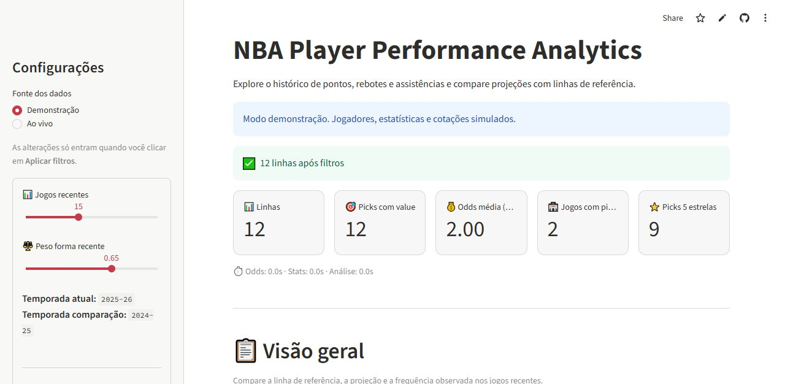
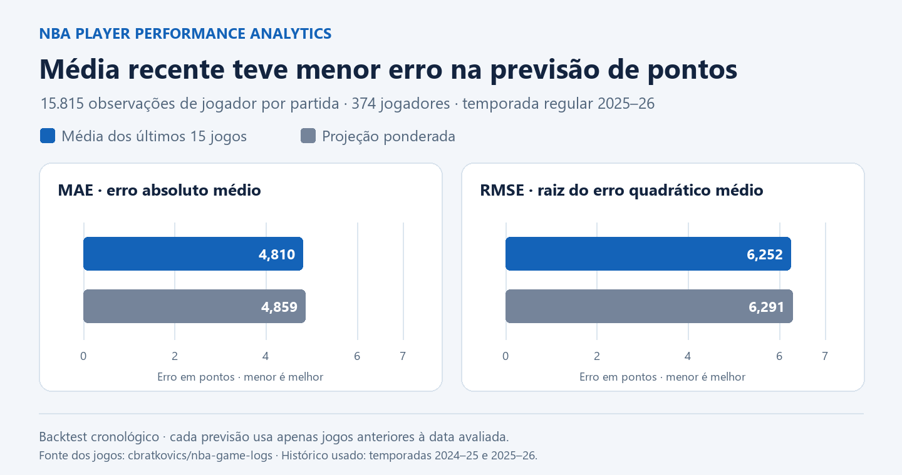

# NBA Player Performance Analytics

[](https://github.com/SavioBarros/NBA-Props/actions/workflows/tests.yml)

Painel em Python para explorar o desempenho de jogadores da NBA e comparar projeções de pontos, rebotes e assistências com linhas de referência. A aplicação combina históricos de partidas e cotações, com uma demonstração offline que abre sem conta ou chave de API.

[**Abrir a demonstração no Streamlit**](https://nba-props-analytics.streamlit.app/)



## Experimente o painel

Com Python 3.11 ou superior, crie e ative um ambiente virtual, depois execute:

```bash
python -m pip install -r requirements.txt
python -m streamlit run streamlit_app.py
```

A **Demonstração** abre por padrão com jogadores, partidas e cotações simulados. Aplique os filtros e selecione uma linha para abrir o gráfico do jogador. A opção **Ao vivo** consulta a The Odds API e a NBA API. Para ativá-la, copie `.streamlit/secrets.example.toml` para `.streamlit/secrets.toml` e preencha `ODDS_API_KEY`. A variável de ambiente com o mesmo nome também é aceita.

## Como a análise funciona

| Etapa | Implementação |
|---|---|
| Coleta | The Odds API para linhas e preços. `nba_api` para estatísticas por partida. |
| Integração | Normalização e correspondência aproximada de nomes com RapidFuzz para associar as fontes. |
| Projeção | Média e dispersão ponderadas entre a forma recente e a temporada anterior. A janela e o peso são ajustáveis. |
| Probabilidades | Aproximação normal com correção de continuidade para contagens. Linhas inteiras separam a probabilidade de devolução. |
| Histórico | Comparação de janelas L5, L10 e L15, de temporadas e de jogos contra o adversário identificado. |
| Visualização | Streamlit, Pandas e Plotly, com exportação das tabelas em CSV e JSON. |

A classificação de uma a cinco estrelas combina a diferença para a probabilidade implícita na cotação e a probabilidade estimada pelo modelo. O estado do modelo é reutilizado no detalhe. A cotação mais alta é escolhida por lado, e a referência sem margem é calculada com o par Over/Under da casa correspondente. As cotações têm cache de 5 minutos, os históricos ao vivo são agrupados por temporada e têm cache de 30 minutos, e os tempos de coleta e análise aparecem no painel.

Se a NBA API estiver indisponível, o painel busca o arquivo público de partidas e informa a data do último registro de cada temporada. O botão de atualização recarrega as cotações e reaproveita os históricos em cache. O filtro **Value mínimo (p.p.)** começa em 5 pontos percentuais. O painel indica separadamente quando faltam históricos para projetar as linhas e quando o filtro elimina as projeções calculadas.

## Estrutura do código

| Caminho | Responsabilidade |
|---|---|
| `app/` | Interface Streamlit, filtros, gráficos e exportações. |
| `src/data/` | Integração com APIs, cache, dados de demonstração e histórico em SQLite. |
| `src/features/` | Séries históricas, janelas recentes, acertos e confrontos diretos. |
| `src/models/` | Projeção, probabilidades, comparação de linhas e rating. |
| `notebooks/` e `tests/` | Análise reproduzível e testes automatizados. |

## Backtest cronológico de pontos

O backtest compara a **média dos últimos N jogos** com a **projeção ponderada**. Para cada jogo, ambos os métodos usam apenas partidas anteriores àquela data. A linha simulada usada na avaliação probabilística é o inteiro abaixo da média recente, mais 0,5. As duas projeções usam a mesma linha e a mesma amostra. O relatório inclui MAE, RMSE, Brier score e curva de calibração.

```bash
python -m nba_props_backtest --demo
python -m nba_history --archive-seasons 2024-25 2025-26 --revision 7339613e45d1bfcb4c98276e764a8b68bea04e30
python -m nba_props_backtest
```

A primeira linha exercita o fluxo com dados simulados. As duas seguintes reproduzem a avaliação com as temporadas regulares 2024–25 e 2025–26 do [arquivo cbratkovics/nba-game-logs](https://huggingface.co/datasets/cbratkovics/nba-game-logs), derivado de dados da NBA. A coleta grava uma linha por jogador e partida no SQLite. Também é possível consultar a NBA API com `--seasons` ou importar arquivos locais com `--parquet` e `--csv`. Para CSV, use as colunas `PLAYER_ID`, `GAME_ID`, `SEASON`, `GAME_DATE` e `PTS`.

O resultado fica em `reports/backtest/`, com previsões, métricas, dados de calibração e um gráfico interativo em `resultado.html`. O notebook [01_backtest.ipynb](notebooks/01_backtest.ipynb) permite inspecionar o mesmo fluxo.

### Resultado com partidas reais



O backtest avaliou **15.815 observações de jogador por partida**, de 374 jogadores, entre 18/11/2025 e 12/04/2026. Cada jogador precisava ter pelo menos 15 jogos anteriores na temporada atual e 15 na anterior. A projeção ponderada atribuiu 65% de peso à forma recente.

| Método | MAE | RMSE | Brier |
|---|---:|---:|---:|
| Média dos últimos 15 jogos | 4,810 | 6,252 | 0,2497 |
| Projeção ponderada | 4,859 | 6,291 | 0,2524 |

A média recente teve o menor erro nas três métricas. O MAE da projeção ponderada ficou cerca de 1% acima do baseline. O Brier usa a linha simulada descrita acima. O arquivo histórico registra sete partidas ausentes em 2024–25 e exclui jogadores que não entraram em quadra.

## Testes, Docker e deploy

```bash
python -m pip install -r requirements-dev.txt
python -m pytest -q
docker build -t nba-props .
docker run --rm -p 8501:8501 nba-props
```

A automação do GitHub executa os testes em pushes e pull requests. A atualização semanal consulta o arquivo histórico público e disponibiliza os relatórios como artefatos da execução. No Streamlit Community Cloud, configure a entrada como `streamlit_app.py`. A demo já funciona sem segredos. Para habilitar os dados ao vivo, cadastre `ODDS_API_KEY` nos Secrets do app.

## Limitações

A aproximação atual usa a estatística bruta do jogador. Minutos esperados, ritmo e defesa adversária são extensões a avaliar. O confronto direto infere o time do jogador pela última partida disponível, o que pode ficar desatualizado após uma transferência. A calibração com linhas simuladas mede desempenho para o limiar definido no backtest. Ela deve ser reavaliada para linhas históricas de mercado.

Veja o [histórico de mudanças](CHANGELOG.md) e a [licença MIT](LICENSE).
